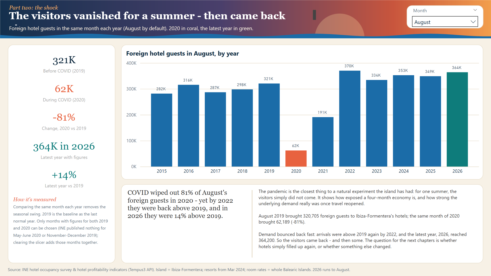

# Ibiza tourism economics

**The business of the White Isle.** Ibiza's hotels are often said to be among the most profitable in Spain. Is that
because they're fuller than everywhere else, or because they charge more?

Everything here comes from Spain's national statistics office (INE) - monthly hotel guests, occupancy and room rates.



## Data

[INE](https://www.ine.es)'s hotel occupancy survey (EOH) and hotel profitability indicators (IRSH), through the free
Tempus3 API (`servicios.ine.es/wstempus`).

INE publishes these at three levels, and each covers a different stretch of time:

- **Island** - "Islas De Ibiza-Formentera" (so Formentera's in there too): guests and nights, monthly, 2000-2026.
  This is what the season and COVID pages use.
- **Resort** - Eivissa (Ibiza Town), Sant Antoni (San Antonio) and Sant Josep (which covers Playa d'en Bossa), plus
  five comparison resorts in Mallorca and around Barcelona: guests, nights, establishments, rooms, occupancy and
  staff. Mostly only from 2024, as it's a new breakdown.
- **Province** - all four Balearic islands together: average daily rate (ADR) and RevPAR, 2008-2026. INE doesn't
  publish prices any lower than this, so the price side of the story is Balearics-wide.

Column details and gaps are in [`data/processed/data_dictionary.md`](data/processed/data_dictionary.md).

## How it's put together

```
INE API -> scripts/ingest.py -> data/raw/*.csv
        -> scripts/build_db.py -> ibiza.duckdb (raw tables + views from sql/01_schema.sql)
        -> scripts/check_data.py (sql/03_checks.sql)
        -> scripts/export_processed.py -> data/processed/*.csv (star schema)
        -> Power BI
```

`sql/01_schema.sql` splits INE's long series names into proper columns and pivots everything to one row per place per
month. `sql/02_analysis.sql` has the analysis queries, including the price/volume bridge (income change split into a
price effect and a volume effect, using nights x ADR since INE doesn't publish hotel revenue).

The Power BI project is in `powerbi/` - see [`powerbi/README.md`](powerbi/README.md).

## Data quality and testing

`sql/03_checks.sql` has ten checks that run after every build, and the pipeline stops before the export if any of them
fail. Each is a query that returns the rows breaking a rule, so an empty result is a pass. The ones that matter most
for INE data:

- **Every measure parsed.** The pivot depends on matching INE's series names. If INE renames one, the column comes out
  empty and this check fails instead of the report quietly showing blanks.
- **Every July and August present.** Winter months are sometimes missing because INE publishes nothing when most
  hotels are shut, so gaps there are expected. A missing summer month would mean a real loss.
- **Guests and occupancy line up.** They come from two different INE tables, so every resort-month in one has to be in
  the other.
- **RevPAR never above ADR.** RevPAR is ADR x occupancy, so a higher RevPAR would mean the two series had been mixed up.

The rest cover duplicates, all eight resorts being loaded, occupancy staying between 0 and 100, and no negative
counts. `tests/` has a few pytest tests for the series-name parsing, the pivot and the checks themselves.

## What I found

More in [`output/narrative_report.md`](output/narrative_report.md).

- August gets about 134 times as many foreign guests as January. In San Antonio, 62 of the 77 hotels open in August
  are shut in April.
- COVID: August foreign guests went from 320,705 (2019) to 62,189 (2020). The full-year total was back to 2019's
  level by 2022 and has kept growing.
- Ibiza isn't the fullest. Three Mallorca resorts (Muro, Pollença, Alcúdia) fill more of their beds in peak season
  than any of Ibiza's three.
- The 2021-22 recovery was about visitors coming back. Growth since 2023 has mostly been prices - Balearic ADR has
  roughly doubled since 2014.

## Running it

Python 3.11 or newer.

```
pip install -r requirements.txt
python scripts/run_pipeline.py            # build the database from data/raw, check it, export data/processed
python scripts/run_pipeline.py --ingest   # same, but pull fresh data from INE first
pytest                                    # unit tests
python scripts/run_analysis.py            # print the analysis queries
python scripts/export_chart_previews.py   # matplotlib previews in output/chart_previews
```

The Power BI report needs Power BI Desktop on Windows. Screenshots of every page are in
[`output/powerbi_exports/`](output/powerbi_exports/).

## Other projects

- [F1 budget cap](https://github.com/Adxmsk1/f1-budget-cap) - did the 2021 cost cap make Formula 1 more competitive?
  Jolpica F1 API, DuckDB and Power BI.
- [Tableau portfolio](https://github.com/Adxmsk1/tableau-portfolio) - three sport dashboards (chess, marathon running
  and ski jumping) built from data I downloaded and scraped myself.
